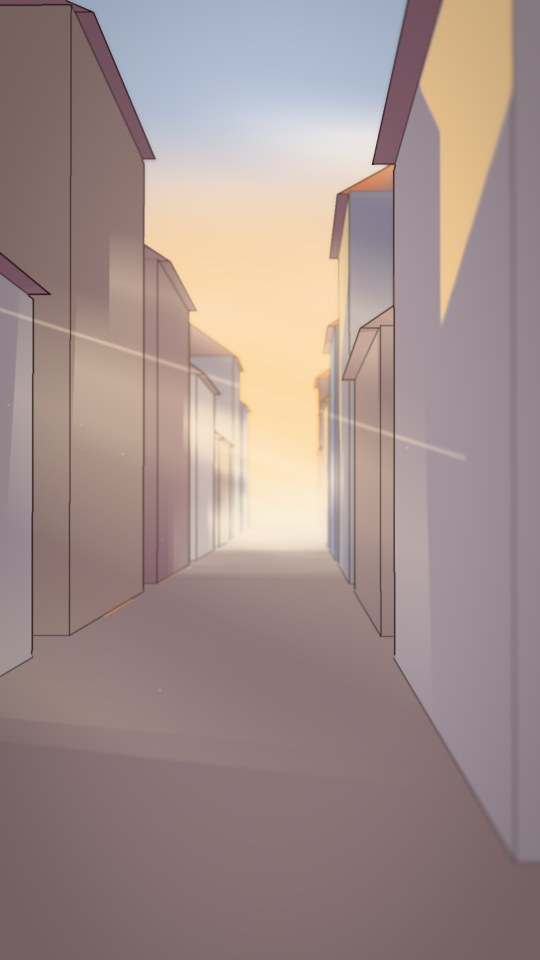
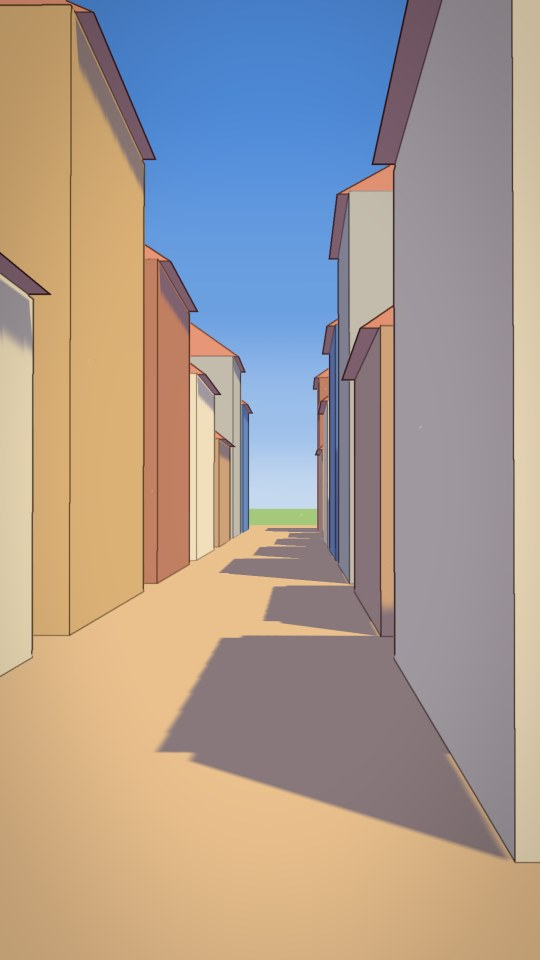
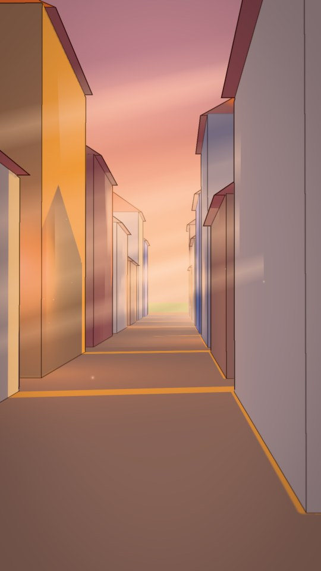
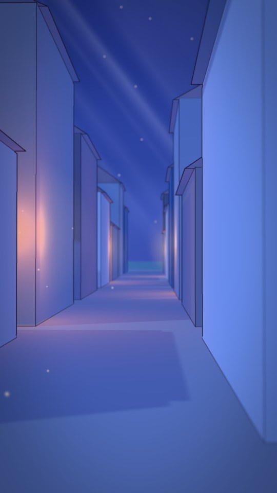

# animated-short

Look dan gaya dunia untuk short vertikal "dunia 3D kartun", dirender dengan three.js di dalam Remotion, tanpa
generator video AI dan tanpa tekstur foto.

Isinya baru yang sudah ditetapkan: **tone** dan **efek** untuk pagi, siang, sore, dan malam (dengan kode yang bisa
langsung dipakai), plus **formula gaya dunia**. Karakter, kamera per adegan, suara, dan audio menyusul.

| Pagi | Siang | Sore | Malam |
|---|---|---|---|
|  |  |  |  |

*Set uji berbentuk polos: yang dinilai di sini hanya tone dan efek.*

## Isi
| Path | Isi |
|---|---|
| `SKILL.md` | Skill Claude: cara pakai, aturan kerja, catatan teknis |
| `templates/dunia/` | Kode look: tone, efek, shading, langit, tinta, blur lensa, grade, komposisi uji `LookTest` |
| `templates/scripts/` | Render still, lembar perbandingan, merge sandbox, `find_asset.py` (cari model 3D + lembar pratinjau) |
| `templates/sandbox_index_example.tsx` | Contoh entry sandbox untuk alur kerja per pemilik file |
| `references/ASSETS.md` | Kalau benda belum ada: cari model jadi, lisensi, muat (`templates/dunia/models.ts`), pustaka teruji |
| `references/STYLE_BIBLE.md` | Ringkasan formula tone, efek, dan gaya dunia |
| `references/reports/` | `CONTEXT`, `lighting`, `depth`, `grade`, `outlines`, `textures` (angka + yang sudah gagal) |
| `references/frames/` | Still `LookTest` per waktu |
| `references/sheets/` | Lembar kontak still `LookTest` |

## Pasang
1. Salin folder ini ke `~/.claude/skills/animated-short/`.
2. Butuh [Remotion](https://www.remotion.dev/) dengan `@remotion/three`, plus Node dan Python 3 (Pillow).
3. Ikuti bagian "Pasang di proyek Remotion" di `SKILL.md`.

## Kredit
Kerangka render (shading dua-tingkat, pass tinta, blur lensa, efek grade, awan lukis) diturunkan dari
[mromidev/claude-animated-shorts](https://github.com/mromidev/claude-animated-shorts) (MIT).

## Lisensi
MIT, lihat `LICENSE`.
